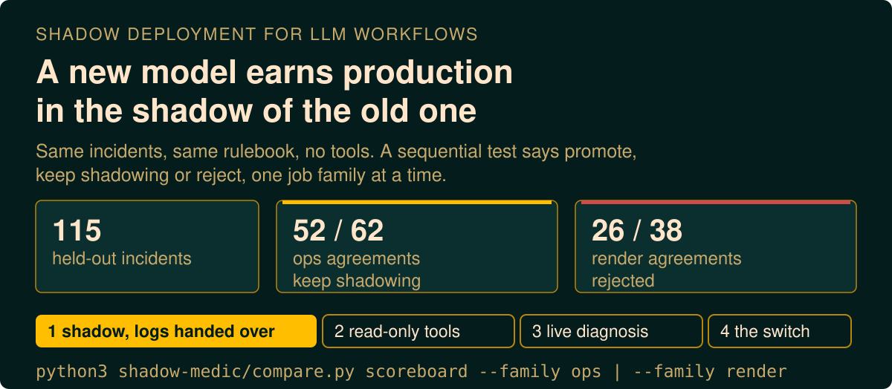
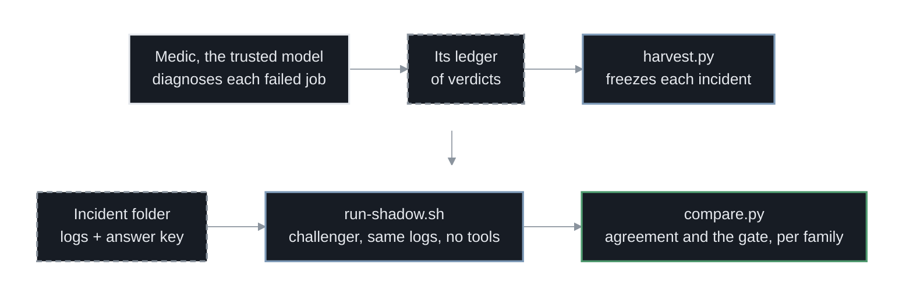
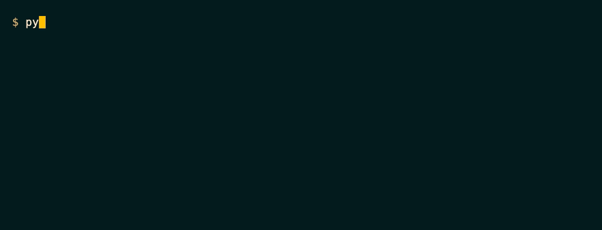
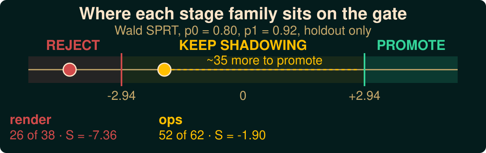
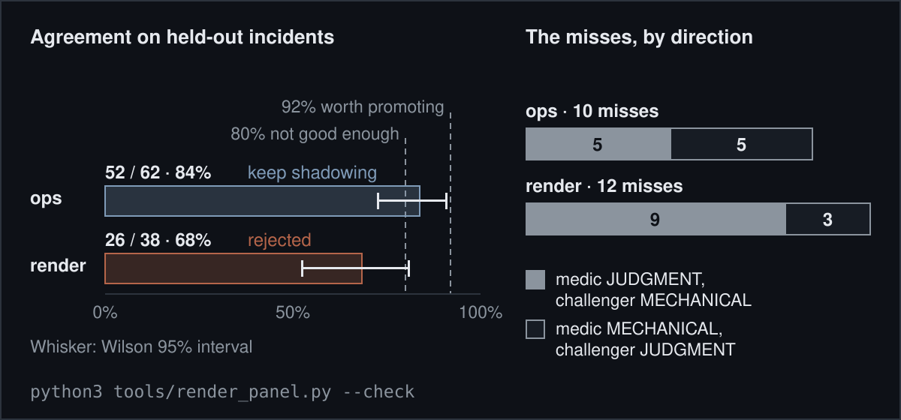
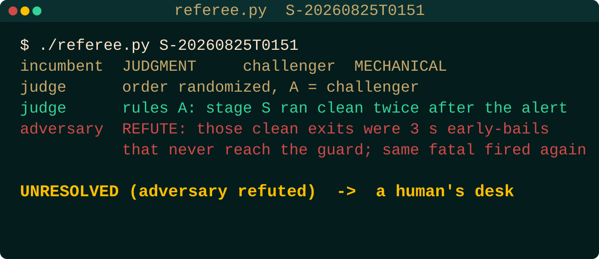
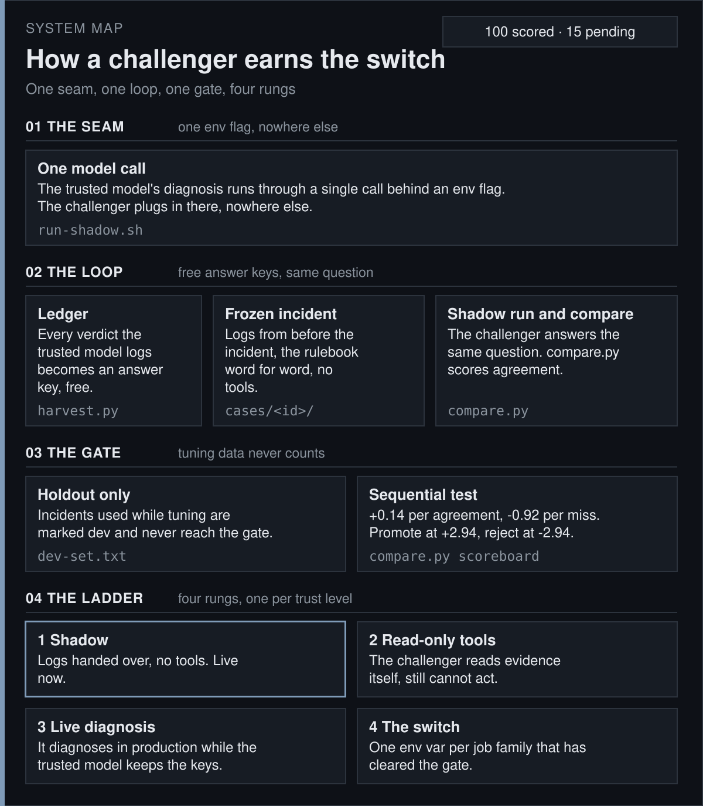

<p align="center">
<a href="https://github.com/jameswniu/production-llm-shadow-deployment-evaluation/actions/workflows/gates.yml"></a>


</p>

<p align="center"><code>ledger -> harvest -> freeze -> shadow -> compare -> gate</code></p>

<div align="center">

&nbsp;&nbsp;&nbsp;&nbsp;&nbsp;&nbsp;<a href="https://github.com/jameswniu/production-llm-shadow-deployment-evaluation/raw/master/media/shadowos-ad.mp4"></a>&nbsp;&nbsp;&nbsp;&nbsp;&nbsp;&nbsp;

<a href="https://github.com/jameswniu/production-llm-shadow-deployment-evaluation/raw/master/media/shadowos-ad.mp4">Watch with sound</a>

</div>

ShadowOS is the tool in this repo. A challenger model works every real incident in the shadow of the model you trust, and a sequential test decides when it has earned the job.

The trusted model here is the medic, a Claude agent that diagnoses every failed job in my fleet of scheduled automation and logs a verdict. The challenger is GLM-5.3, handed the same logs and the medic's rulebook, and no tools.

Every verdict is one of two classes. MECHANICAL means the fix is a rerun or a close by rule, and JUDGMENT means a person has to look. Agreement means the challenger matched the medic's own label, so the bar is no worse than the incumbent, not right in some absolute sense.





## Where the gate stands



- **Ops, 52 of 62:** keeps shadowing. The 95% interval runs from 73% to 91%. Two more misses would reject it. From zero, 22 straight agreements promote, and from today's score about 35.
- **Render, 26 of 38:** rejected. The misses turn on rules that live in the render tooling, not in the rulebook the challenger was handed.
- **The wait:** nine straight agreements only reach +1.26 against a promote line of +2.94.
- **The switch:** per job family, never one flag, and today it is true for neither.



The scoreboard is a sequential probability ratio test (SPRT). The running score S promotes at +2.94 and rejects at -2.94. H0 says the challenger agrees 80% of the time (p0), which is not good enough, and the alternative says 92% (p1). Alpha and beta cap the odds of a wrong promote or a wrong reject at 5%, and wilson95 is the confidence interval for the agreement rate.

```
$ ./compare.py scoreboard --family ops
[holdout] agreement 52/62 = 84%  wilson95=[73%, 91%]  pending=8
SPRT p0=0.8 p1=0.92 alpha=0.05 beta=0.05: S=-1.90 bounds=[-2.94, +2.94] -> CONTINUE

$ ./compare.py scoreboard --family render
[holdout] agreement 26/38 = 68%  wilson95=[53%, 81%]  pending=7
SPRT p0=0.8 p1=0.92 alpha=0.05 beta=0.05: S=-7.36 bounds=[-2.94, +2.94] -> REJECT (H0)
```

> Pending incidents arrived after the challenger runs stopped. CI reruns both commands, the badges and every figure on each push, and fails if anything on this page drifts from what the code prints.

## One incident, start to finish

Incident `F-20260822T1811` comes from stage F, the job that renders a short hologram-style avatar clip (a holoblack clip), and it was held out of tuning. Here is the stage log the challenger saw, then both verdicts.

```
17:45:56  rendering holoblack clip (model claude-sonnet-5, budget $20.0)
          The render is still processing on HeyGen's side. I'll wait for the
          background timer notification before checking again.
18:04:28  no output from the render leg; checking HeyGen for a completed orphan
          The video with that exact title exists but its status is 'processing'
18:05:10  failed rc=0, no output
18:05:12  alert, stage F: no holoblack clip was rendered
18:10:34  The clip rendered clean and is delivered.

medic       MECHANICAL  the worker gave up its wait with rc=0 and no file while
                        the render was still alive
challenger  MECHANICAL  render still 'processing' at the 18:04:28 check, so the
                        18:05:12 alert heals as stale
result      MATCH       9,429 tokens, and every time it cited exists in the log
```

## Where it missed

| Family | Misses | Medic said JUDGMENT, challenger said MECHANICAL | Medic said MECHANICAL, challenger said JUDGMENT |
|---|---|---|---|
| Ops | 10 of 62 | 5 | 5 |
| Render | 12 of 38 | 9 | 3 |

On render the challenger mostly called a human-judgment case mechanical. Those rules live in the render tooling, and moving one of them into the prompt turned a tuning-set miss into a match. Every incident, hit or miss, has a row in [`docs/verdicts.md`](docs/verdicts.md).

## When the answer key might be wrong



- **The answer key:** the medic's label is the reference, not the truth. When the two disagree, `referee.py` gives the case to a blind judge with the two verdicts in random order, then tells a second judge to refute the ruling.
- **Seven disagreements so far:** three rulings stood, all for the challenger. Four were refuted and went to a person, each one a case where the medic said JUDGMENT and the challenger said MECHANICAL.

## How a challenger earns the switch



1. Shadow with the logs handed over and no tools. This is the rung that has run.
2. Shadow with read-only tools, so the challenger finds the evidence itself.
3. Diagnose live while the medic still acts and still holds the keys.
4. Flip one environment variable at the seam for each family that cleared the gate.

**Only held-out incidents count.** Incidents used while tuning the prompt are marked dev and never reach the gate, and a promotion between rungs resets if the challenger invents a single log line.

## What this page cannot show you

- **Scope:** one operator, one fleet, one challenger. My own scheduled jobs, one incumbent's labels, GLM-5.3 as the challenger and a local llama3.1:8b as the weak control.
- **Not independent trials:** incidents from the same job are correlated, though the test treats them as independent.
- **A hard-coded family rule:** stages D, E and F are render, everything else is ops.
- **Shipped logs:** 8 of 130 incidents carry them, all render, so the ops result rests on verdicts you can count but not reread.
- **Power:** only the first rung has run, and a tight claim near 90% agreement would need about 400 incidents, four times what is here.

## Quick start

```bash
git clone https://github.com/jameswniu/production-llm-shadow-deployment-evaluation
cd production-llm-shadow-deployment-evaluation/shadow-medic
python3 check-readme-scoreboard.py
bash run-tests.sh
```

> Python 3.12, no keys, no installs, no network calls after the clone.

The first command reruns the gate and checks every number, badge and figure on this page. The second runs the 275 redaction, harvest and storage tests. The 123 challenger runs that logged token counts used 1,651,323 tokens, about 13,400 per incident.

## Point it at your own workflow

Find the one seam where your agent calls its model, point `SHADOW_LEDGER` at whatever log records what it decided (the harvester reads four fields, `at`, `stage`, `action` and `note`), and run `python3 harvest.py --dry-run`. The walkthrough with a `meta.json` example is in [`docs/adopt.md`](docs/adopt.md).

```bash
cd shadow-medic
bash run-shadow.sh api llama3.1:8b cases/F-20260822T1811
GLM_API_KEY=your-key bash run-shadow.sh zai glm-5.3 cases/F-20260822T1811
python3 compare.py compare cases/F-20260822T1811 results/shadow-F-20260822T1811-*.md
```

Or paste this into Claude Code.

```
Read https://github.com/jameswniu/production-llm-shadow-deployment-evaluation and set up the same shadow-migration lane for my workflow. Find the one seam where my agent calls its model, harvest cases from the ledger that records what it decided, transplant its rulebook verbatim into the prompt template, run the challenger on the same frozen evidence with no tools, score agreement against what my incumbent actually did, and gate per job family with an SPRT on holdout only. Redact before anything leaves the machine.
```

## What ships, and what stays private

- **Verdicts:** every one ships, so every number reruns. The scoreboard reads three fields per incident, the medic's class, the split and the challenger's class. The other 122 incidents ship only those fields plus the SHA-256 of the private original. 77 come from jobs that act on my personal accounts, and 45 were not cleared line by line.
- **Logs:** the 8 that ship are scrubbed. Paths, project names, links, emails and long ids are swapped for placeholders like `[project]`. CI checks them for emails, phone numbers, ids and links, but not for names, because a name check needs each incident's private roster. Names were redacted when each incident was frozen, and every shipped log was read line by line before release.

> Seven rules the instrument learned the hard way, each at the price of one wrong verdict, are in [`docs/boundary.md`](docs/boundary.md).

## Files

| File | What it does |
|---|---|
| `shadow-medic/harvest.py` | Turns the medic's ledger into frozen incident folders |
| `shadow-medic/run-shadow.sh` | Runs one incident through one model route, after a leak check on the exact prompt |
| `shadow-medic/compare.py` | Leak check, redaction, comparison and the scoreboard |
| `shadow-medic/referee.py` | Settles a disagreement with a blind judge, then a second judge told to refute it |
| `shadow-medic/check-readme-scoreboard.py` | Fails when this page's numbers, badges or figures drift from the code |
| `tools/` | Generates every figure and the verdict table from the repo's own data |
| `bin/hermes-env.sh` | Environment for Hermes, an open agent harness that can also run the challenger, sourced and never run |

Licensed under Apache 2.0.
