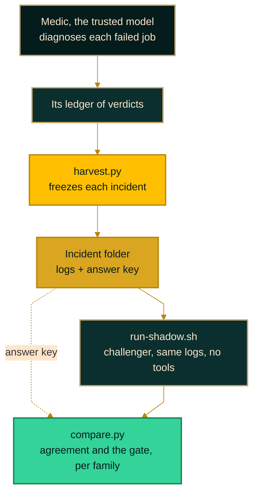

<div align="center">

<h1>Production LLM Shadow Deployment Evaluation</h1>

<a href="https://github.com/jameswniu/production-llm-shadow-deployment-evaluation/actions/workflows/gates.yml"></a>


&nbsp;&nbsp;&nbsp;&nbsp;&nbsp;&nbsp;<a href="https://github.com/jameswniu/production-llm-shadow-deployment-evaluation/raw/master/media/shadowos-ad.mp4"></a>&nbsp;&nbsp;&nbsp;&nbsp;&nbsp;&nbsp;

<a href="https://github.com/jameswniu/production-llm-shadow-deployment-evaluation/raw/master/media/shadowos-ad.mp4">Watch with sound</a>

</div>

**ShadowOS swaps the model behind a production AI workflow on evidence, not faith.**

A challenger model works every real incident in the shadow of the model you trust, and a sequential test decides when it has earned the job. Across 100 held-out incidents from my own fleet of scheduled jobs, it matched the trusted model on 52 of 62 ops incidents and 26 of 38 render incidents. The test says keep shadowing on ops and reject on render.

## Where the gate stands


The trusted model is the medic, a Claude agent in my fleet that diagnoses every failed job and logs a verdict. The challenger is GLM-5.3, handed the same logs and no tools. Ops covers scheduled automation such as syncs and cleanups, and render covers avatar video renders.

- **Ops, 52 of 62, keep shadowing.** The 95% interval runs from 73% to 91%. Two more misses would reject it, and about 35 straight agreements would promote it.
- **Render, 26 of 38, rejected.** The misses turn on rules that live in the render tooling, not in the playbook the challenger was handed. Moving one such rule into the prompt turned a tuning-set miss into a match.
- **The gate was right to wait.** Nine straight agreements only reach +1.26 against a promote line of +2.94, so even a perfect start keeps shadowing. All 62 ops incidents together hold 10 misses.
- **So the switch is per family, never one flag.** Today it is true for neither.

```
$ ./compare.py scoreboard --family ops
[holdout] agreement 52/62 = 84%  wilson95=[73%, 91%]  pending=8
SPRT p0=0.8 p1=0.92 alpha=0.05 beta=0.05: S=-1.90 bounds=[-2.94, +2.94] -> CONTINUE

$ ./compare.py scoreboard --family render
[holdout] agreement 26/38 = 68%  wilson95=[53%, 81%]  pending=7
SPRT p0=0.8 p1=0.92 alpha=0.05 beta=0.05: S=-7.36 bounds=[-2.94, +2.94] -> REJECT (H0)
```

Pending incidents arrived after the challenger runs stopped, so they have no verdict. CI reruns both commands on every push and fails if this block or the chart drifts from what the code prints.

## Quick start

Python 3.12 is all it needs. There are no keys, no installs and no network calls after the clone.

```bash
git clone https://github.com/jameswniu/production-llm-shadow-deployment-evaluation
cd production-llm-shadow-deployment-evaluation/shadow-medic
python3 check-readme-scoreboard.py
bash run-tests.sh
```

The first command reruns the gate for both families and checks every number on this page against it. The second runs the redaction, harvest and storage tests.

## How a swap earns its way in



- **The labels are free.** Every verdict the medic writes to its ledger becomes an answer key, so each production incident is a test case at no labelling cost.
- **The challenger sees what the medic saw, and nothing after.** It gets the logs from before the incident and the medic's rulebook word for word.
- **Only held-out incidents count.** Incidents used while tuning the prompt are marked dev and never reach the gate.
- **A sequential probability ratio test (SPRT) reads the score after every incident.** Each agreement adds 0.14, each miss subtracts 0.92, and crossing 2.94 either way ends it.
- **Trust comes in four steps, called rungs.** First the challenger shadows with the logs handed over, then with read-only tools, then diagnoses live while the medic still acts, and last the switch for that family. Only the first rung has run.

## What ships, and what stays private

- **Every verdict ships, so every number reruns.** The scoreboard reads three fields per incident, the medic's class, the split and the challenger's class.
- **8 incidents ship with full logs**, all video render jobs, so you can rerun a model on them. Seven of them are among the 100 held-out incidents the gate scored, so most scored verdicts are stubs. Paths, private project names, links, emails and long ids are swapped for placeholders like `[project]` and `[link]`.
- **The other 122 come from jobs that act on my personal accounts.** Only their three fields ship, each with the SHA-256 of the private original.
- **The verdicts were made on the logs before that extra scrub**, so a rerun reads slightly different text.
- **CI checks shipped logs for emails, phone numbers, ids and links, but not for names**, because a name check needs each incident's private roster. Names were redacted when each incident was frozen, and every shipped log was read line by line before release.

## Rerun the model yourself

```bash
cd shadow-medic
bash run-shadow.sh api llama3.1:8b cases/F-20260822T1811
GLM_API_KEY=your-key bash run-shadow.sh zai glm-5.3 cases/F-20260822T1811
python3 compare.py compare cases/F-20260822T1811 results/shadow-F-20260822T1811-*.md
```

The first line runs a local model through Ollama for free. The second runs the original challenger with your own Z.ai key, and `hermes` in place of `zai` sends the same prompt through the Hermes agent harness after `source ../bin/hermes-env.sh`. Building incidents from your own fleet needs its ledger, so point `SHADOW_LEDGER` at it and run `python3 harvest.py --dry-run` first.

## Paste this into Claude Code

```
Read https://github.com/jameswniu/production-llm-shadow-deployment-evaluation and set up the same shadow-migration lane for my workflow.

Find the one seam where my agent calls its model. Harvest cases from whatever ledger or log
already records what that agent decided. Transplant its doctrine verbatim into a prompt
template, run the challenger on the same frozen evidence with no tools, and score agreement
against what my incumbent actually did. Gate per stage family with an SPRT on holdout only.
Redact before anything leaves the machine.
```

## Rules the instrument learned the hard way

Each of these cost one wrong verdict before it became a rule. The longer stories are in [`docs/boundary.md`](docs/boundary.md).

- **Evidence looks only backward.** A log window that runs past the incident lets the challenger watch the job recover.
- **The rulebook transfers word for word.** A paraphrase dropped one rule and cost one wrong class.
- **The class comes from the medic's note, not its action verb.** A closed ticket can still be a judgment call.
- **An empty result is pending, not a miss.** Runners create their output file before they write to it.

## Files

| File | What it does |
|---|---|
| `shadow-medic/harvest.py` | Turns the medic's ledger into frozen incident folders |
| `shadow-medic/run-shadow.sh` | Runs one incident through one model route |
| `shadow-medic/compare.py` | Leak check, redaction, comparison and the scoreboard |
| `shadow-medic/referee.py` | Settles a disagreement with a blind judge, then a second judge told to refute it |
| `shadow-medic/check-readme-scoreboard.py` | Fails when this page's numbers drift from the code |
| `bin/hermes-env.sh` | A repo-local home for the Hermes harness, sourced and never run |

Licensed under Apache 2.0.
